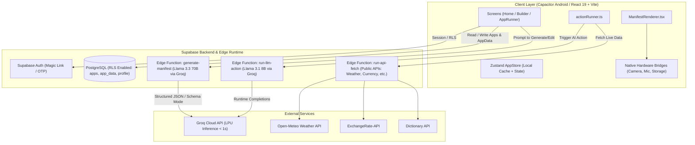
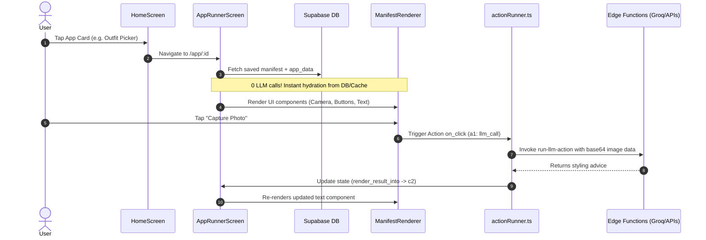

# 📱 Simple — Product Architecture & Implementation Guide

> **"Describe it. Build it. Use it."**  
> A declarative, Server-Driven UI (SDUI) personal micro-app platform powered by Groq and Supabase, packaged for Android via Capacitor.

---

## 1. Product Goal & Philosophy

### 1.1 The Core Problem
Most modern "AI app builders" or code generation tools (v0, Bolt, Lovable, Claude Artifacts) output raw HTML, CSS, and JavaScript. While impressive, this approach has critical flaws when targeting mobile end-users:
- **Security & Sandbox Risks:** Executing arbitrary generated code in a mobile app WebView with camera, microphone, and filesystem permissions is a severe security vulnerability.
- **Fragility & Hallucination:** Code can break easily due to dependency mismatch, syntax errors, or runtime exceptions.
- **Inconsistent UI/UX:** Free-form generation results in mismatched styles, broken mobile layouts, and unpredictable designs.
- **High Latency & Token Burn:** Loading an app repeatedly should not require invoking a large language model each time.

### 1.2 The "Simple" Solution
**Simple** is a mobile-first personal micro-app generator designed with a strict, non-negotiable architectural constraint: **The LLM never outputs code.**

Instead:
1. **The LLM is a Compiler/Planner:** It translates natural language instructions into a strictly typed, schema-validated JSON manifest (`ManifestSchema`).
2. **Deterministic UI Renderer:** A native component library renders the manifest into fixed, hardened React components.
3. **Zero-LLM on Open:** Once an app is saved, opening it requires **0 LLM calls** and loads instantly from local state or Supabase DB.
4. **Nothing OS Design Language:** Built with a minimalist, monochrome, dot-matrix visual aesthetic (inspired by Nothing OS and Teenage Engineering), giving all user-generated apps a cohesive, premium feel.

---

## 2. High-Level System Architecture



---

## 3. End-to-End User Journeys & Data Flows

### 3.1 App Creation / Generation Flow
1. **User Prompt:** The user opens the **Builder Screen** and types a request (e.g., *"Make a daily habit tracker"* or *"Outfit recommender using my camera"*).
2. **Edge Invocation:** `supabase.functions.invoke('generate-manifest')` is called with:
   - `user_prompt`: The natural language request.
   - `conversation_context`: Recent prompt history (last 6 messages).
   - `existing_manifest`: (Optional) Included when iteratively editing an existing app.
3. **Groq Model Generation:**
   - Model: `llama-3.3-70b-versatile` running with low temperature (`0.3`).
   - JSON Schema Mode (`json_schema`) enforces strict compliance with `MANIFEST_JSON_SCHEMA`.
4. **Deterministic Validation & Auto-Repair Loop:**
   - Server-side validation inspects:
     - Component IDs and known component types.
     - Action IDs, valid action kinds, and valid API endpoints.
     - Referential integrity: `render_result_into` points to an existing component ID; `on_click` points to an existing action ID.
   - If invalid, the model enters a self-correction loop (up to 3 retries) with specific error diffs.
5. **Live Canvas Preview:** The generated manifest is returned to the client and rendered in real-time in the builder canvas using `ManifestRenderer`.
6. **Persistence:** When the user taps **SAVE**, the app is inserted into the Supabase `apps` table and pinned to the user's home screen.

### 3.2 Saved App Execution (Zero-LLM on Open)


---

## 4. Manifest Schema: The Architectural Contract

The bridge between AI generation and UI rendering is strictly governed by `manifest.schema.ts`:

### 4.1 Component Schema (`ComponentSchema`)
Every UI element in the app corresponds to a predefined, typed React component:

| Component Type | Description | Props / Bindings |
|---|---|---|
| `text` | Formatted markdown/plain text block | `props.content`, can bind to `app_data` |
| `card` | Titled container for structured content | `props.title`, `props.body` |
| `button` | Action trigger | `props.label`, `on_click` (action ID) |
| `checklist` | Interactive, persistent habit/todo checklist | `props.items: string[]`, with progress bar |
| `calculator` | Full offline arithmetic keypad | Completely self-contained, zero network |
| `clock` | Live ticking clock with timezone support | `props.timezone`, `props.format` (12h/24h) |
| `image_capture` | Native camera shutter / web file picker | Capacitor Camera, saves to `app_data` |
| `image_gallery` | Multi-image preview grid | `props.images: string[]` or bound state |
| `mic_recorder` | Voice transcription microphone | Native SpeechRecognition bridge |
| `mcq_quiz` | Interactive multiple-choice question quiz | `props.questions: [{question, options, correct_index}]` |
| `chat_bubble` | Single conversational message bubble | `props.role`, `props.content` |
| `conversation_loop` | Multi-turn AI voice/text interactive loop | `props.persona_prompt`, lightweight Llama 3.1 8B |

### 4.2 Action Schema (`ActionSchema`)
Actions define what happens when a user interacts with a component:
- `llm_call`: Injects `{{variables}}` from `app_data` into `prompt_template`, calls Groq, renders into `render_result_into`.
- `local_compute`: Instant deterministic math/string ops (`add`, `subtract`, `multiply`, `divide`, `concat`, `count`, `get_current_time`, `format_date`) — 0 network, 0 tokens.
- `api_fetch`: Server-side proxy calling allowlisted public APIs (`weather`, `currency`, `timezone`, `dictionary`, `country`, `trivia`).
- `navigate`: Client-side route changes.
- `save_data`: Persists local variables into the `app_data` table.
- `conversation_loop`: Hands off multi-turn chat handling to the conversational runner.

---

## 5. Technology Stack Breakdown

| Layer | Technology | Role & Why Chosen |
|---|---|---|
| **Mobile Runtime** | Capacitor 8 (Android) | Wraps React web into a native Android APK with hardware bridge access (Camera, Mic, Filesystem) without app-store review friction for generated mini-apps. |
| **Frontend Framework** | React 19 + TypeScript + Vite | Blazing fast HMR, strict type safety, zero-bundle-bloat build. |
| **Styling & Theme** | Tailwind CSS + Doto font | Enforces a strict Nothing OS monochrome design language (`#0a0a0a` background, white accents, dot-matrix typography). |
| **State Management** | Zustand 5 | Minimal footprint, reactive global store handling session, manifest builder canvas, and cached apps. |
| **Validation** | Zod 4 | Runtime validation of LLM outputs; acts as the primary deterministic compiler gatekeeper. |
| **Backend & Database** | Supabase (PostgreSQL + RLS) | Managed authentication (OTP magic links), PostgreSQL with row-level security policies, serverless Edge functions. |
| **Inference Engine** | Groq Cloud SDK | Ultra-low latency LPU inference (< 500ms response time for Llama 3.3 70B and Llama 3.1 8B), enabling instant generative UI without noticeable lag. |
| **Testing** | Vitest 4 | Unit testing framework validating schema parsing and component constraints. |

---

## 6. Security & Sandboxing Model

1. **No `eval()` or Code Injection:**
   - No dynamic JS, HTML `dangerouslySetInnerHTML`, or CSS scripts are ever executed from the LLM.
   - All components are hardcoded React elements with bounded properties.
2. **Row Level Security (RLS) from Day 1:**
   - `apps`: Users can only read and write apps where `auth.uid() = user_id`.
   - `app_data`: Users can only access key-value records for apps they own.
   - `profile`: Strictly isolated to the owning user.
3. **Server-Side API Key Secrecy:**
   - Groq API keys and upstream services are never bundled with the client application or APK. They live strictly inside Supabase Edge Function environment variables.
4. **Hardware Permission Sandboxing:**
   - Camera and Microphone access are gated by native OS permission prompts managed by Capacitor.

---

## 7. Directory Structure Reference

```text
simple-app/
├── android/                   # Capacitor Android native project & Gradle build
├── public/                    # Static assets & Doto/Space Mono web fonts
├── src/
│   ├── actions/               # Runtime interaction executors (runAction, compute, fetch)
│   ├── components/            # 12 fixed, styled UI building blocks
│   ├── lib/                   # Supabase client singleton & Zustand store
│   ├── renderer/              # ManifestRenderer (JSON -> React tree mapper)
│   ├── schema/                # Zod validation schema & test suites
│   ├── screens/               # AuthScreen, HomeScreen, BuilderScreen, AppRunnerScreen
│   ├── App.tsx                # AuthGuard and HashRouter configuration
│   ├── index.css              # Nothing OS typography, mesh gradients, dot animations
│   └── main.tsx               # App entrypoint
├── supabase/
│   ├── functions/             # Deno Edge Functions (generate-manifest, run-llm-action, run-api-fetch)
│   └── migrations/            # Postgres DDL: apps, app_data, profile with RLS policies
├── capacitor.config.ts        # Capacitor mobile packaging config
├── tailwind.config.js         # Custom monochrome color tokens and keyframes
└── vite.config.ts             # Vite build & path alias config
```

