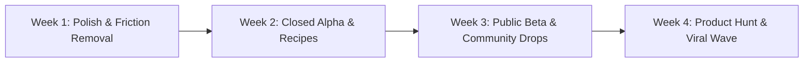

# 🚀 Go-To-Market & Launch Strategy: "Simple"

> **How to take "Simple" from a local build to high-retention user adoption.**

---

## 1. The Core Launch Problem & Paradigm Shift

### Why Generative Tools Often Stall:
1. **The "Blank Canvas" Paradox:** When presented with an empty prompt bar, casual users freeze. They don't know what to ask for, or they ask for something impossible (like "build Facebook"), get disappointed, and churn.
2. **The Auth Wall Drop-off:** Asking for an email and magic link before a user has seen a single moment of product value kills 60–80% of top-of-funnel traffic.
3. **The Sideload Barrier:** Asking non-technical users to download an unverified `.apk` file triggers security warnings on Android.

### The Winning Launch Formula:
```
Show Magic First (0-click demo) 
  → Give 1-Click Recipes (eliminate blank canvas) 
  → Enable Web Playground (zero download) 
  → Convert to Installed Mobile App (via PWA or Play Store)
```

---

## 2. The 4 Strategic Pillars for Launch

### Pillar 1: Zero-Friction "Guest Mode" (Instant Web Demo)
- **Change:** Allow first-time visitors on web or mobile to build **1 micro-app without logging in**.
- **Mechanism:** Store their generated manifest in browser `localStorage`.
- **The Conversion Hook:** When the user taps *"Save App"* or *"Add to Home Screen"*, trigger the magic link sign-in modal with:
  > *"Sign in with email to keep this app and sync it across your devices."*
- **Outcome:** The user is already emotionally invested in something they created before being asked for credentials.

### Pillar 2: The "Nothing Phone / Minimalist Tech" Cult Positioning
Simple’s UI is not generic; it has an intense, high-taste identity (monochrome `#0a0a0a`, Doto dot-matrix typography, tactile micro-animations).
- **Target Audience:** Enthusiasts of Nothing OS, Pebble watches, Teenage Engineering devices, and Minimalist Android Launchers (Niagara, Before Launcher, Olauncher).
- **Campaign Angle:** *"Your phone has too many bloated apps. Build your own ultra-minimal personal utilities in 3 seconds."*
- **Channels:**
  - Reddit: `r/NothingTech`, `r/androidthemes`, `r/minimalism`, `r/SideProject`
  - Nothing Community Forums & Discord channels
  - X / Twitter tech design circles (#buildinpublic, #indiedev)

### Pillar 3: "App Recipes" & One-Click Viral Sharing
Instead of asking users to dream up an app from scratch, launch with a **Curated Recipe Shelf**:
1. **The Feynman Voice Coach:** Quizzes you out loud on complex concepts until you can explain them simply.
2. **The Minimal Outfit Stylist:** Snaps your daily outfit, evaluates contrast and style, and logs your wardrobe.
3. **The Global Freelancer Dashboard:** Live multi-timezone clock + real-time currency exchange rates.
4. **The Daily 5 Habit Matrix:** Minimalist habit tracker with completion progress.
5. **The Quick Spanish Flashcard Deck:** Interactive MCQ quizzes.

**Viral Mechanics:**
- Every app gets a shareable link (e.g., `simple.app/r/feynman-coach`) or an **aesthetic Dot-Matrix QR code**.
- When shared on social media or group chats, clicking the link opens the functional app directly in the recipient's mobile browser, with a prominent button: **"Clone & Tweak in Simple"**.

### Pillar 4: Web + PWA First, Google Play Store Second
- **Do not rely solely on direct APK downloads.** Deploy the web version to a domain (e.g., `simple.build` or via Vercel/Cloudflare Pages) with Progressive Web App (PWA) manifest support.
- Users on iOS and Android can tap **"Add to Home Screen"** immediately.
- Package the Capacitor build for the **Google Play Store** to establish trust and discoverability for native Android camera/mic features.

---

## 3. Phased 30-Day Launch Roadmap



### Phase 1: Week 1 — Polish & Friction Removal
- [ ] Add **Guest Mode** (allow building 1 app using local memory before forcing Auth).
- [ ] Deploy client to a live web URL (Vercel/Netlify/Cloudflare) alongside Supabase.
- [ ] Add 6 pre-built, one-tap demo apps on the home screen for instant exploration.
- [ ] Test camera and microphone fallback gracefully on web vs Android.

### Phase 2: Week 2 — Closed Alpha & Content Assets
- [ ] Record high-energy **15-second screen recordings** showing the prompt typing, sub-second Groq generation, and instant app interaction.
- [ ] Share with 50-100 beta testers in Nothing Phone and tech enthusiast communities.
- [ ] Gather the top 10 most common failed user prompts and expand the capability registry or error guidance accordingly.

### Phase 3: Week 3 — Community Infiltration & Show HN
- [ ] **Show HN (Hacker News):**
  - *Title:* "Show HN: Simple – Build personal micro-apps via SDUI without executing raw code"
  - *Focus:* Explain the architectural decision of JSON Schema SDUI vs fragile raw code execution, sub-second Groq inference, and security benefits.
- [ ] **Reddit Posts in Niche Communities:**
  - Share screenshots of the Doto dot-matrix clock, calculator, and habit tracker running on a dark phone screen.
  - Title: *"Built a generative personal app builder with Nothing OS aesthetic"*.

### Phase 4: Week 4 — Product Hunt & Scaling
- [ ] Launch on **Product Hunt** (Tuesday or Wednesday 12:01 AM PST).
  - Tagline: *"Describe it. Build it. Use it. Personal micro-apps in 3 seconds."*
  - Deliverables: Clean GIF carousel showing generation, recipe shelf, and native camera/mic features.
- [ ] Distribute the top 5 "App Recipe" links on X/Twitter with downloadable QR cards.

---

## 4. Monetization & Sustainability Framework

| Tier | Price | Features | Target User |
|---|---|---|---|
| **Free Explorer** | \$0 | Up to 5 active personal apps, standard Groq model speed, access to public recipe shelf. | Casual everyday users |
| **Simple Pro** | \$5 / month | Unlimited mini-apps, unlimited voice conversation loops, priority generation, export to standalone PWA shortcut. | Students, self-improvement power users |
| **BYOK (Power)** | \$2 / month (or free tier) | Use your own Groq/Anthropic/OpenAI API key stored in encrypted `profile.byo_api_key`. | Developers, AI enthusiasts |

---

## 5. Summary Checklist for Immediate Action

1. **Remove upfront auth block:** Let visitors try 1 prompt immediately on web.
2. **Deploy web preview:** Make it shareable with a simple URL.
3. **Create the Recipe Gallery:** Turn the 4 example prompts on `HomeScreen.tsx` into instant 1-tap clones.
4. **Publish a 30s demonstration clip** highlighting the Nothing OS aesthetic and Groq speed.

