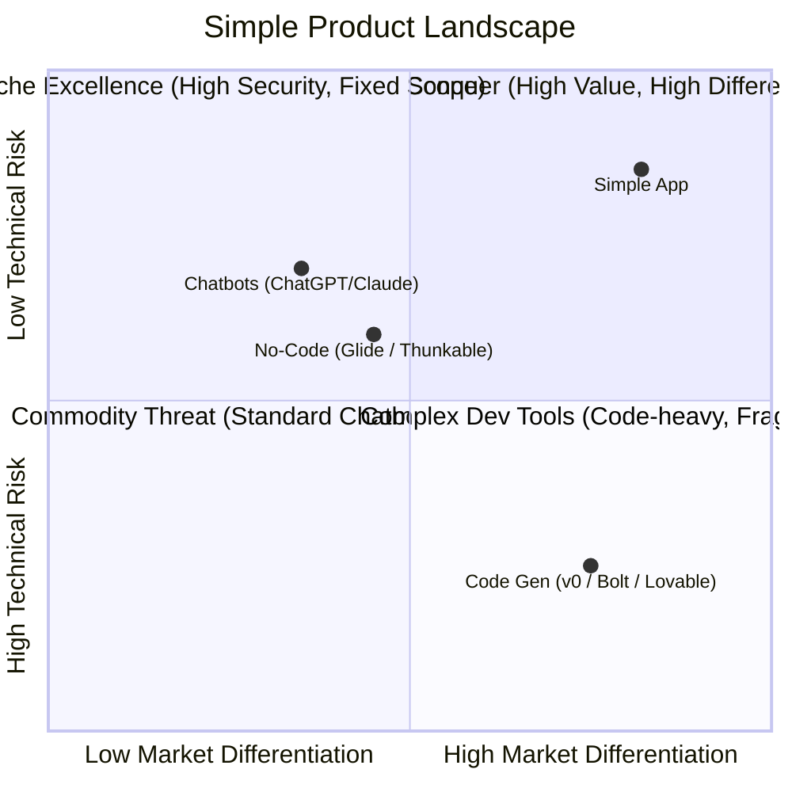

# 📊 Comprehensive SWOT Analysis & Strategic Roadmap: "Simple"

> **Product:** Simple — Declarative Generative Micro-App Platform  
> **Market Sector:** Generative AI Consumer Utilities, No-Code Mobile Development, Personal Software  
> **Analysis Date:** 2026-11-07  

---

## Executive Summary

**Simple** occupies a unique strategic sweet spot between heavy, full-stack AI coding tools (e.g., Cursor, v0, Bolt.new) and generic AI chatbots (ChatGPT, Claude). Rather than outputting vulnerable or volatile raw code, Simple uses a **Server-Driven UI (SDUI) architecture** driven by schema-validated JSON manifests. This guarantees security, deterministic offline capabilities, native mobile camera/mic integrations, and sub-second generation speeds via Groq.

However, its fixed component library naturally limits design variability, and requiring authentication before any user value is demonstrated creates an early funnel bottleneck. 

This document details an exhaustive SWOT analysis and provides an actionable strategic plan to scale and launch the product effectively.

---

## 1. SWOT Matrix Overview



---

## 2. Detailed SWOT Breakdown

### 2.1 Strengths (Internal Advantages)

| # | Strength | Impact & Competitive Edge |
|---|---|---|
| **S1** | **Zero-Code Execution Risk (Safe SDUI)** | By rendering only predefined, hardened React components through a schema-validated JSON manifest, Simple completely eliminates XSS, arbitrary script execution, and mobile WebView exploits. |
| **S2** | **Zero-Token Cost & Instant Launch on Open** | Once an app is created and saved, launching it does **not** invoke an LLM. It loads instantaneously from local state / Supabase, avoiding the recurring latency and high API bills common in wrapper apps. |
| **S3** | **Sub-Second Generation via Groq LPUs** | Leveraging `llama-3.3-70b-versatile` on Groq delivers structured JSON in under 1 second. The build feedback loop feels instantaneous compared to 20-40s waits on traditional cloud LLMs. |
| **S4** | **Hybrid Hardware & Offline Widgets** | Includes native Android camera and microphone hooks through Capacitor alongside 100% offline, zero-network widgets (`calculator`, `clock`, `local_compute`). |
| **S5** | **Iconic Visual Identity (Nothing OS Aesthetic)** | The dark monochrome theme (`#0a0a0a`), dot-matrix Doto typography, and minimalist glyphs give it an unmistakable, cohesive personality that stands out against generic consumer apps. |
| **S6** | **Deterministic Auto-Repair Loop** | The Zod schema validator checks the manifest directly on the edge. If the LLM generates an invalid prop or dangling action link, it automatically repairs itself within 3 attempts before reaching the user. |
| **S7** | **Zero-Backend Client Architecture** | All secrets and AI integrations remain server-side in Supabase Edge Functions. The client is a lightweight, tamper-resistant shell. |

---

### 2.2 Weaknesses (Internal Limitations)

| # | Weakness | Impact & Vulnerability |
|---|---|---|
| **W1** | **Bounded Component Expressiveness** | Because the LLM cannot write custom CSS or arbitrary components, users cannot create arbitrary UI (e.g., custom data charts, interactive maps, complex animations, or 2D canvas games). |
| **W2** | **Onboarding Friction (Auth Wall Upfront)** | The current user flow requires entering an email and verifying a magic link before the user can see or build a single app, causing high drop-off during initial discovery. |
| **W3** | **Single Point of Failure on Third-Party APIs** | Features like live weather, currency exchange, and dictionary depend on free, unauthenticated public APIs (Open-Meteo, ExchangeRate-API). Outages or rate limits directly affect app reliability. |
| **W4** | **Single Model Provider Dependency** | Built tightly around Groq Cloud. Any Groq API downtime or pricing change can disrupt generation and conversation features if fallback providers (e.g., Together AI, Cerebras, Anthropic) are not implemented. |
| **W5** | **Lack of Social / Community Sharing** | All apps are strictly siloed to the individual user's account (`auth.uid() = user_id`). Users cannot currently publish, share via URL/QR code, or fork each other's mini-apps. |
| **W6** | **Limited Persistence Primitives** | The `app_data` table stores simple key-value pairs. Storing complex relational data, multi-item records, or user-uploaded media files has limited abstraction in the current manifest schema. |

---

### 2.3 Opportunities (External Potentials)

| # | Opportunity | Strategic Growth Potential |
|---|---|---|
| **O1** | **The "Nothing Community" & Minimalist Tech Wave** | A passionate community of Nothing OS, Pebble, Teenage Engineering, and minimalist phone enthusiasts actively seeks apps that respect this aesthetic. Simple fits this culture seamlessly. |
| **O2** | **Viral "Remix" App Recipes & QR Sharing** | Introducing single-tap sharing (e.g., `simple.app/r/habit-tracker` or a scannable dot-matrix QR code) allows creators to publish useful personal tools on social media, sparking viral organic acquisition. |
| **O3** | **Local / On-Device SLM Inference (WebLLM / MediaPipe)** | With lightweight models (e.g., Gemma 2B, Llama 3.2 1B, SmolLM), manifest compilation and basic actions could run entirely on-device, achieving true 100% offline personal computing. |
| **O4** | **Bring-Your-Own-Key (BYOK) & Pro Subscriptions** | The database schema already features a `byo_api_key` field in the `profile` table. Power users can bring their own keys for heavy voice/AI tasks, while a freemium tier monetizes casual users. |
| **O5** | **Expanded Capability Registry & Plugin Hooks** | Adding 5-10 high-value components (e.g., audio player, timer/stopwatch, basic bar/line charts, barcode scanner, notification scheduler) unlocks hundreds of new micro-app categories. |
| **O6** | **B2B / Internal Micro-Tool Prototyping** | Teams frequently need fast, internal utility forms, checklist audits, and inspection apps without spinning up engineering sprints. |

---

### 2.4 Threats (External Risks)

| # | Threat | Risk Mitigation |
|---|---|---|
| **T1** | **Rapid Evolution of Big Tech AI Canvas Features** | OpenAI (Canvas), Anthropic (Artifacts), and Google (Gemini) are evolving rapidly. If mobile chat apps integrate one-tap widget saving, competition will intensify. |
| **T2** | **App Store Dynamic Code Policies** | While Simple does not execute raw JavaScript (it only interprets declarative JSON), app store reviewers sometimes misunderstand generative tools. Messaging must clearly explain its SDUI nature. |
| **T3** | **User Expectation vs. Reality Gap** | When users are told "build any app," they may request full SaaS platforms (e.g., "build me Instagram" or "build a ride-sharing app"). Disappointment can lead to churn unless capability boundaries are communicated upfront. |
| **T4** | **API Cost Scaling with High Active Users** | If hundreds of thousands of users run continuous voice loops (`conversation_loop`) or daily LLM actions, token costs can accumulate without a sustainable monetization model. |

---

## 3. Strategic TOWS Matrix (Action Plan)

```
                       ┌───────────────────────────────┬───────────────────────────────┐
                       │          STRENGTHS            │          WEAKNESSES           │
                       │  - Safe JSON SDUI             │  - Bounded components         │
                       │  - Sub-second Groq inference  │  - Upfront Auth Wall          │
                       │  - 0-token open / offline     │  - Single provider dependence │
                       │  - Nothing OS aesthetic       │  - No sharing/remixing yet    │
───────────────────────┼───────────────────────────────┼───────────────────────────────┤
OPPORTUNITIES          │   SO Strategies (Maxi-Maxi)   │   WO Strategies (Mini-Maxi)   │
- Viral App Recipes     │ 1. Launch "Recipe Gallery"    │ 1. Guest Mode / Instant Try:  │
- Nothing OS fanbase   │    where users share apps via │    Let users build & preview  │
- On-device local SLM  │    one-click QR codes.        │    before signing up.         │
- BYOK / Pro tier      │ 2. Target Nothing OS & tech   │ 2. Implement Provider Failover│
- New components       │    enthusiast subreddits with │    (Groq -> Cerebras/OpenAI). │
                       │    custom launcher aesthetics.│ 3. Add Top-5 requested widgets│
                       │                               │    (Timer, Charts, Barcode).  │
───────────────────────┼───────────────────────────────┼───────────────────────────────┤
THREATS                │   ST Strategies (Maxi-Mini)   │   WT Strategies (Mini-Mini)   │
- Big tech artifacts   │ 1. Emphasize "Zero Bloat, Real│ 1. Transparent Capability UI: │
- App store policies   │    Personal Apps" vs clumsy   │    Show users exact capabilities│
- Token cost scaling   │    chatbots.                  │    before they type a prompt. │
- Unrealistic user ask │ 2. Emphasize compliance with  │ 2. Rate limiting & Free Quota:│
                       │    App Store rules via SDUI.  │    5 free apps/month; BYOK or │
                       │                               │    Pro for unlimited.         │
───────────────────────┴───────────────────────────────┴───────────────────────────────┘
```

---

## 4. Key Takeaways for Product Evolution

1. **Keep the Core Intact:** The decision to avoid executing arbitrary code and use a strict JSON manifest is Simple's greatest asset. Never compromise this for quick hacks.
2. **Remove the Front Door Friction:** Enable a **Playground / Guest Mode** immediately. Users should be able to type a prompt on the web and interact with a generated app within 5 seconds without creating an account.
3. **Turn Apps into Social Currency:** Allow users to export apps as links (`simple.to/app/feynman-physics`). The recipient opens the app, tests it, and clicks "Save to my Simple". This turns every user into a viral acquisition channel.
4. **Monetize Sustainable Usage:** Free users get 3-5 active mini-apps with standard Groq speeds. Power users unlock unlimited apps, voice tutor hours, and BYOK integration.

