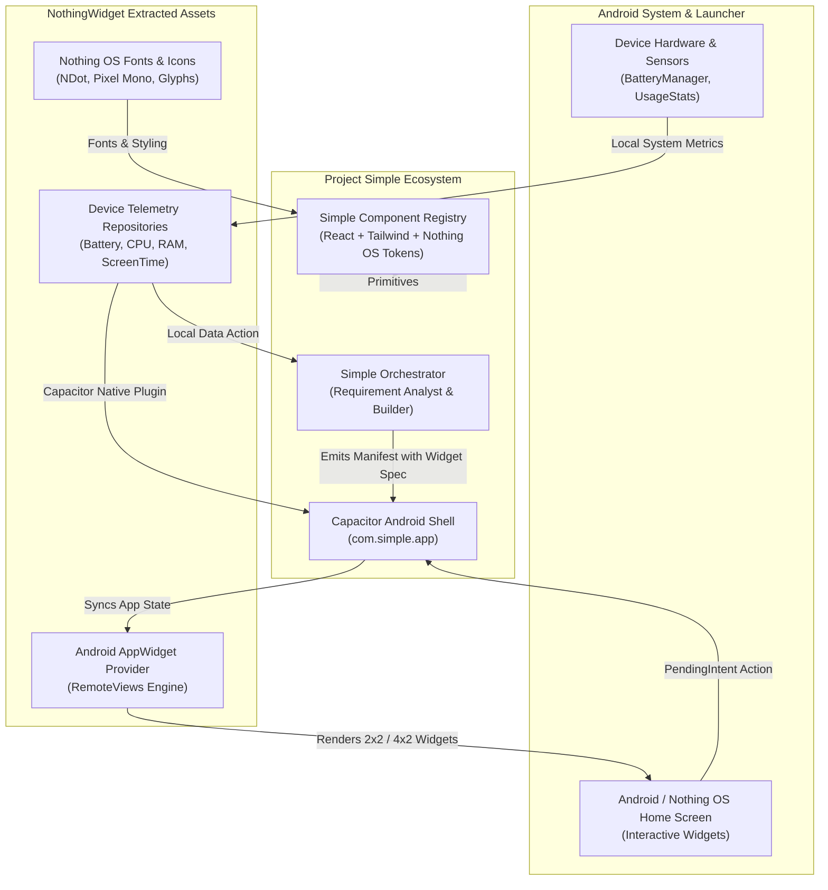

# Strategic Analysis & Technical Roadmap: Leveraging NothingWidget for Project "Simple"

> **Author:** Antigravity Engineering  
> **Target Repository:** [`https://github.com/bijay085/NothingWidget.git`](https://github.com/bijay085/NothingWidget.git) (MIT License, Copyright 2026 bijay085)  
> **Target Platform:** Project Simple (`d:\Documents\Projects\Simple Project\Simple\simple-app`)  
> **Status:** Strategic Assessment & Implementation Blueprints  

---

## 1. Executive Summary & Strategic Alignment

### 1.1 The Context: Simple's Product Mission
Project **Simple** is an AI-native application generator designed to turn natural language prompts into persistent, functional personal tools on a user's phone. Simple operates on the core architectural principle: **"Simple connects; it does not reinvent."** It avoids generative code execution in favour of schema-validated manifests, a co-located component registry, and connectors (MCP servers, device capabilities, and open-source UI kits).

In Simple's authoritative specification (`SIMPLE_V2_SPEC.md`, Section 1), the primary launch beachhead is explicitly defined as:
> **"Prosumer tinkerers (Android/Nothing users, Home Assistant owners, Notion/Shortcuts users) and students."**

Furthermore, Simple's existing web design system (`tailwind.config.js`, `index.css`, `Clock.tsx`) is already styled with the **Nothing OS aesthetic**: monochrome dark palettes (`n-bg`, `n-surface`, `n-border`), dot-grid background meshes, Space Mono typography, and Doto dot-matrix digital displays.

### 1.2 What is NothingWidget?
**NothingWidget** is an open-source (MIT), zero-ongoing-cost Android native widget platform designed specifically for Nothing OS / Android 12+ (API 31+). Built using Kotlin, Jetpack Compose, RemoteViews, DataStore, and WorkManager, it provides:
1. **Isolated Native Widgets**: Round Clock, Device Health (Battery + Performance pages), Screen Time (compact & large multi-app ranking), Quick Actions (hardware flashlight, QR scanner, app triggers), and Open-Meteo Weather.
2. **Deep Local Device Telemetry ($0 Cost, Zero Cloud)**: Highly optimized native Kotlin harvesters for BatteryManager, ActivityManager, Storage StatFs, CPU sampling via cpuidle sysfs, and wall-clock foreground screen time via UsageEvents.
3. **Interactive Widget Architecture**: Real-time widget page turning (`PageStateRepository`) and state updates directly on the Android home launcher without launching the app.
4. **Decoupled Customization Engine**: Element-by-element configuration of fonts (NDot, Digital, Space Mono, Pixel Mono), colors, sizes, and visibility.

### 1.3 The Core Unlock for Simple
Currently, Simple apps run exclusively inside a full-screen Capacitor WebView shell or PWA. **The single biggest barrier to persistent daily utility for personal micro-apps on Android is the need to launch an app container.**

Micro-tools—such as light switches, habit check-offs, daily clocks, battery monitors, and screen time goals—deliver **10x higher engagement and utility when pinned directly to the Android home screen**. 

By leveraging NothingWidget, Simple can:
1. **Transform into a Native Android Home-Screen Widget Generator**: Allow users to pin their generated micro-tools directly to the Nothing OS launcher.
2. **Incorporate Local Device Hardware Capabilities**: Equip Simple's Orchestrator with native device sensors (battery cycle counts, temperature, wattage, RAM, storage, and screen time) at $0 cost and zero cloud dependencies.
3. **Expand the Component Registry**: Introduce iconic Nothing-styled components (`round_clock`, `device_health_gauge`, `screen_time_card`, `quick_actions_deck`).
4. **Offer In-App & Widget Customization**: Adopt NothingWidget's modular element-level styling engine.

---

## 2. Technical Audit of NothingWidget

```
NothingWidget Architecture
app/
├── src/main/java/com/phoenix/nothingwidget/
│   ├── core/
│   │   ├── settings/           # Global preferences (DataStore)
│   │   ├── widget_config/      # StylePresets, ElementStyleConfig, CustomizationRepo
│   │   └── widget_state/       # PageStateRepository (multi-page widget paging)
│   ├── widgets/
│   │   ├── device_health/      # BatteryHealthRepository, PerformanceRepository
│   │   ├── quick_actions/      # QuickActionsFlashlight, QuickActionsIntents
│   │   ├── round_clock/        # RoundClockRenderer, multiple font layouts
│   │   ├── screen_time/        # UsageStatsManager, UsageEvents wall-clock parser
│   │   ├── screen_time_large/  # Multi-app ranked usage breakdown
│   │   └── weather/            # OpenMeteoWeatherClient (Keyless, HTTPURLConnection)
└── src/widgets/*/res/          # Modular, isolated RemoteViews layouts & drawables
```

### 2.1 Widget Inventory & Capabilities

| Widget | Key Responsibilities | Android APIs Used | Key Files |
|---|---|---|---|
| **Device Health** | 2-page widget: **Battery** (%, status, temp °C, health %, cycle count, voltage, wattage, time to full) + **Performance** (CPU %, RAM used/total, storage used/total, temp). | `BatteryManager`, `ActivityManager`, `StatFs`, `/proc/stat` & `/sys/devices/system/cpu/` cpuidle state deltas. | `BatteryHealthRepository.kt`<br>`PerformanceRepository.kt`<br>`DeviceHealthRenderer.kt` |
| **Round Clock** | Iconic circular Nothing-styled analog/digital clock. Displays time, day, date, and next alarm with customizable fonts (NDot, Digital, Sans, Pixel Mono). | `AppWidgetManager`, `AlarmClock`, `RemoteViews.setClockFormat`. | `RoundClockRenderer.kt`<br>`RoundClockCustomization.kt` |
| **Screen Time (Compact & Large)** | Daily foreground screen time matching Digital Wellbeing. Large edition ranks top 12 apps with minutes spent and progress bars. Page navigation for additional apps. | `UsageStatsManager.queryEvents`, `AppOpsManager`, `PackageManager`. | `ScreenTimeRepository.kt`<br>`ScreenTimeLargeRenderer.kt` |
| **Quick Actions** | 4×1 tactile launcher row triggering flashlight, camera, QR scan, calculator, notes, or custom intents. | `CameraManager` (Torch), `Intent.ACTION_VIEW`. | `QuickActionsFlashlight.kt`<br>`QuickActionsIntents.kt` |
| **Weather** | Live weather condition icons, temperature, condition badges. Fully keyless, free public API. | `OpenMeteoWeatherClient` (HTTPS connection to Open-Meteo, zero API key), `FusedLocationProviderClient`. | `OpenMeteoWeatherClient.kt`<br>`WeatherRefreshWorker.kt` |

### 2.2 Key Architectural Patterns in NothingWidget
1. **Interactive Multi-Page Widgets via RemoteViews**:
   - RemoteViews in Android cannot run custom JavaScript or arbitrary event listeners. NothingWidget solves multi-page widget navigation (e.g. Battery Page ↔ Performance Page) cleanly using `PageStateRepository` and broadcast `PendingIntent`s targeted at `AppWidgetProvider`. The widget flips views instantly without waking the main application.
2. **Zero-Permission / System-Setting Permitted Telemetry**:
   - `BatteryHealthRepository` uses sticky `ACTION_BATTERY_CHANGED` broadcasts which require **zero user permissions**.
   - `ScreenTimeRepository` accurately calculates foreground wall-clock time from `UsageEvents`, filtering out launcher and System UI noise, and provides a direct intent helper (`Settings.ACTION_USAGE_ACCESS_SETTINGS`) to guide the user.
3. **Modular Resource Isolation**:
   - In `app/build.gradle.kts`, custom Gradle sourceSets automatically scan `src/widgets/*/res`. Each widget maintains its own layouts, drawables, and strings without polluting global namespaces.
4. **Strict $0 Cost Constraint**:
   - As documented in `NothingWidget/AGENTS.md`, all features are strictly bounded by $0 ongoing cost: zero paid subscriptions, zero mandatory SaaS, and local storage over cloud dependencies.

---

## 3. Four Strategic Leverage Pillars for Project "Simple"



### Pillar 1: The Native Android Home-Screen Widget Bridge (The 10x UX Multiplier)
* **The Opportunity**: Simple builds persistent personal micro-apps. However, asking a user to open an app just to check their habit tracker, toggle a smart lamp, or view an exam countdown introduces friction.
* **The Solution**: Adapt NothingWidget's `AppWidgetProvider` + `RemoteViews` engine into a Capacitor plugin for Simple (`@simple/capacitor-widgets`).
* **Workflow**:
  1. When a user generates an app in Simple (e.g., "A Tokyo & London dual clock" or "Living room light toggle"), the manifest includes a `widget` descriptor:
     ```json
     {
       "widget": {
         "supported_sizes": ["2x2", "4x2"],
         "template": "clock_dual",
         "primary_action": "toggle_light"
       }
     }
     ```
  2. Simple saves the app to Supabase / local SQLite and immediately writes the current state to Android `SharedPreferences` via the Capacitor bridge.
  3. The user can long-press their Nothing Phone home screen, select "Simple Widgets", and pin the generated tool.
  4. Interactions (such as checking off an item or tapping a toggle) trigger an Android `BroadcastReceiver` that updates the `RemoteViews` instantly and forwards the action to Simple's background runner.

### Pillar 2: Native Device Telemetry & Sensors ("Local Device MCP Connector")
* **The Opportunity**: In `simple-architecture-functionality-first.md`, Simple's capability model connects to external MCP servers (Home Assistant, Weather). However, Simple currently has **zero insight into the physical device it lives on**.
* **The Solution**: Port `BatteryHealthRepository.kt`, `PerformanceRepository.kt`, and `ScreenTimeRepository.kt` into a native Capacitor plugin (`@simple/device-metrics`).
* **New Micro-Apps Simple Can Now Generate with Zero Cloud Cost**:
  - *"Create a battery health monitor that alerts me when charging temperature exceeds 38°C."*
  - *"Build a focus tracker comparing my YouTube screen time to my daily reading goal."*
  - *"Give me a system cleaner widget showing RAM, storage left, and CPU load."*
  - *"Make a quick launch dock with flashlight, QR scanner, and my custom Simple apps."*

### Pillar 3: Component Registry Expansion (Nothing OS Web Primitives)
Simple's component registry (`src/registry/entries/`) currently contains 23 components. We can port the visual concepts from NothingWidget into official Simple registry entries:

| New Component Type | Visual Inspiration from NothingWidget | Value to Simple |
|---|---|---|
| `round_clock` | NothingWidget circular clock with outer second dot ring, date badges, and NDot typography. | Upgrades Simple's current rectangular card clock to a stunning, iconic Nothing circular timepiece. |
| `device_health_gauge` | Circular & segmented battery/RAM progress rings with red accent highlights (`#FF5A5A`). | Reusable metric gauge for any numeric progress, battery, target completion, or fitness stat. |
| `screen_time_card` | Ranked horizontal bar chart showing top app usage with app icon, duration in hrs/mins, and percentage bar. | Perfect for personal productivity, habit apps, and digital wellbeing tools. |
| `quick_actions_grid` | 4×1 and 2×2 button matrices featuring minimalist line icons, tactile active states, and red dot indicators. | Replaces generic button stacks with an authentic Nothing OS control deck for IoT and home automation. |

### Pillar 4: Dynamic Customization Engine in Simple
* **The Opportunity**: In NothingWidget, users can customize any widget by selecting fonts (NDot, Digital, Space Mono, Pixel Mono), accent colors (White, Red, Green, Cyan), and toggle elements (glow effects, seconds display).
* **The Solution**: Adopt NothingWidget's `ElementStyleConfig` schema into Simple's `ManifestRenderer`. Simple users can enter an "Appearance" mode on any generated app to toggle between dot-matrix styling, brutalist monochrome, or minimalist layouts without prompting the LLM again.

---

## 4. Architectural Blueprints & Implementation Details

### 4.1 Capacitor Widget Bridge Architecture

To connect Simple's React/TypeScript layer to NothingWidget's native Android RemoteViews:

```
┌────────────────────────────────────────────────────────┐
│  Simple React Application (Web / Capacitor Client)     │
│  - Zustand App Store                                   │
│  - ManifestRenderer                                    │
│  - Calls: SimpleWidget.syncWidgetData(appId, payload)  │
└──────────────────────────┬─────────────────────────────┘
                           │ Capacitor Bridge
┌──────────────────────────▼─────────────────────────────┐
│  SimpleWidgetPlugin.kt (Android Native Plugin)         │
│  - Receives JSON payload from Web runtime               │
│  - Persists data to SharedPreferences ("simple_widgets")│
│  - Calls AppWidgetManager.updateAppWidget()            │
└──────────────────────────┬─────────────────────────────┘
                           │ RemoteViews Update
┌──────────────────────────▼─────────────────────────────┐
│  SimpleAppWidgetProvider.kt (from NothingWidget)       │
│  - Loads layout from res/layout/widget_*.xml           │
│  - Populates views with text, colors, click intents    │
│  - Dispatches user taps back to actionRunner           │
└────────────────────────────────────────────────────────┘
```

#### Blueprint: Native Capacitor Plugin Definition
```kotlin
package com.simple.app.plugins

import android.appwidget.AppWidgetManager
import android.content.ComponentName
import android.content.Context
import android.content.Intent
import com.getcapacitor.JSObject
import com.getcapacitor.Plugin
import com.getcapacitor.PluginCall
import com.getcapacitor.PluginMethod
import com.getcapacitor.annotation.CapacitorPlugin
import com.simple.app.widgets.SimpleAppWidgetReceiver

@CapacitorPlugin(name = "SimpleWidget")
class SimpleWidgetPlugin : Plugin() {

    @PluginMethod
    fun syncWidget(call: PluginCall) {
        val appId = call.getString("appId") ?: return call.reject("Missing appId")
        val data = call.getObject("data") ?: return call.reject("Missing data")

        val context = context
        val prefs = context.getSharedPreferences("simple_widget_state", Context.MODE_PRIVATE)
        prefs.edit().putString("widget_${appId}", data.toString()).apply()

        // Trigger AppWidget update
        val intent = Intent(context, SimpleAppWidgetReceiver::class.java).apply {
            action = AppWidgetManager.ACTION_APPWIDGET_UPDATE
            val manager = AppWidgetManager.getInstance(context)
            val ids = manager.getAppWidgetIds(ComponentName(context, SimpleAppWidgetReceiver::class.java))
            putExtra(AppWidgetManager.EXTRA_APPWIDGET_IDS, ids)
        }
        context.sendBroadcast(intent)
        call.resolve()
    }
}
```

### 4.2 Blueprint: Device Metrics Native Plugin

Exposing NothingWidget's `BatteryHealthRepository` and `PerformanceRepository` to Simple:

```kotlin
package com.simple.app.plugins

import com.getcapacitor.JSObject
import com.getcapacitor.Plugin
import com.getcapacitor.PluginCall
import com.getcapacitor.PluginMethod
import com.getcapacitor.annotation.CapacitorPlugin
import com.phoenix.nothingwidget.widgets.device_health.BatteryHealthRepository
import com.phoenix.nothingwidget.widgets.device_health.PerformanceRepository
import com.phoenix.nothingwidget.widgets.screen_time.ScreenTimeRepository

@CapacitorPlugin(name = "DeviceMetrics")
class DeviceMetricsPlugin : Plugin() {

    @PluginMethod
    fun getBatteryMetrics(call: PluginCall) {
        val health = BatteryHealthRepository.read(context)
        val ret = JSObject().apply {
            put("percentage", health.percentage)
            put("status", health.statusSimple)
            put("temperature", health.temperature)
            put("cycleCount", health.cycleCount)
            put("voltage", health.voltage)
            put("power", health.power)
            put("healthPercent", health.health)
        }
        call.resolve(ret)
    }

    @PluginMethod
    fun getPerformanceMetrics(call: PluginCall) {
        val perf = PerformanceRepository.read(context)
        val ret = JSObject().apply {
            put("cpuUsage", perf.cpuUsage)
            put("ramUsed", perf.ramUsed)
            put("ramTotal", perf.ramTotal)
            put("storageUsed", perf.storageUsed)
            put("storageTotal", perf.storageTotal)
            put("deviceTemp", perf.deviceTemperature)
        }
        call.resolve(ret)
    }

    @PluginMethod
    fun getScreenTimeToday(call: PluginCall) {
        if (!ScreenTimeRepository.hasUsageAccess(context)) {
            val ret = JSObject().apply {
                put("hasPermission", false)
                put("totalMinutes", 0)
            }
            return call.resolve(ret)
        }
        val model = ScreenTimeRepository.loadToday(context)
        val ret = JSObject().apply {
            put("hasPermission", true)
            put("totalFormatted", model.formattedTotal)
            put("topApp", model.topAppName)
            put("topAppDuration", model.formattedTopAppDuration)
        }
        call.resolve(ret)
    }
}
```

### 4.3 Blueprint: New Registry Entry in Simple (`round_clock.ts`)

```typescript
import { z } from "zod";
import { RoundClockAdapter } from "../adapters";
import type { RegistryEntry } from "../types";

const propsSchema = z
  .object({
    timezone: z.string().optional(),
    format: z.enum(["12h", "24h"]).optional(),
    font: z.enum(["ndot", "digital", "space_mono", "pixel"]).optional(),
    showAlarm: z.boolean().optional(),
    accentColor: z.enum(["red", "white", "gray"]).optional(),
    label: z.string().optional(),
  })
  .strict();

type Props = z.infer<typeof propsSchema>;

export const roundClockEntry: RegistryEntry<Props, "round_clock"> = {
  type: "round_clock",
  propsSchema,
  component: RoundClockAdapter,
  llmDescription: `Use \`round_clock\` to display an iconic Nothing OS-inspired circular dial clock with ticking second perimeter and dot-matrix time.
Props:
- timezone (string, optional): IANA timezone string e.g. "Asia/Tokyo". Defaults to device timezone.
- format ("12h" | "24h", optional): Time format. Default "12h".
- font ("ndot" | "digital" | "space_mono" | "pixel", optional): Typography style. Default "ndot".
- showAlarm (boolean, optional): Display next scheduled alarm. Default false.
- accentColor ("red" | "white" | "gray", optional): Highlight color. Default "red".
- label (string, optional): Header city or context text.
Example: { type: "round_clock", props: { timezone: "Europe/London", font: "ndot", accentColor: "red", label: "LONDON HQ" } }`,
  requiredPermissions: [],
  examples: [
    { props: { timezone: "UTC", font: "ndot", accentColor: "red", label: "UTC" } },
    { props: { format: "24h", font: "digital" } },
  ],
};
```

---

## 5. Phased Integration Roadmap

| Phase | Milestone | Deliverables | Estimated Effort |
|---|---|---|---|
| **Phase 1: Design & Registry Enrichment** | Port NothingWidget's visual identity & font assets into Simple's Web layer. | - Import font assets (`space_grotesk.ttf`, `pixel_mono.ttf`).<br>- Add `round_clock`, `stat_gauge`, and `quick_actions_deck` to `src/registry/`.<br>- Update Orchestrator prompt & seed templates. | **1–2 Days** |
| **Phase 2: Local Device Telemetry Plugin** | Wrap NothingWidget's Kotlin repositories as a Capacitor native plugin. | - Add `DeviceMetricsPlugin.kt` to `android/app/`.<br>- Port `BatteryHealthRepository` and `PerformanceRepository`.<br>- Add `device_metrics` local capability to Simple Orchestrator. | **3–4 Days** |
| **Phase 3: Android Home-Screen Widget Bridge** | Enable pinning Simple apps to the Android home screen via RemoteViews. | - Add `SimpleWidgetPlugin.kt` & `SimpleAppWidgetReceiver.kt`.<br>- Port NothingWidget's 2×2 and 4×2 RemoteViews layout XMLs into Simple's Android build.<br>- Add "Add to Home Screen" action in Simple's AppRunner. | **1–2 Weeks** |
| **Phase 4: Interactive Multi-Page Launcher Widgets** | Bring NothingWidget's `PageStateRepository` & zero-launch interactions to Simple widgets. | - Handle widget button taps (`PendingIntent`) without launching Simple.<br>- Implement widget background sync via WorkManager.<br>- Live customization dialog for widget colors/fonts. | **2 Weeks** |

---

## 6. Risk, Security, & Licensing Evaluation

### 6.1 Licensing & Intellectual Property
* **NothingWidget License**: Standard **MIT License** (Copyright 2026 bijay085).
  - Permits commercial use, modification, distribution, and private use.
  - Requirement: Retain the copyright notice and permission notice in adapted source files.
* **Fonts**:
  - `Space Grotesk` & `Space Mono`: Licensed under the SIL Open Font License (OFL 1.1) — free to bundle and modify.
  - `Doto`: Google Fonts OFL — already integrated into Simple.
  - Other custom fonts (`dark_spooky.ttf`, `pixel_mono.ttf`): Verify respective licenses prior to commercial release; substitute with open-source equivalents if ambiguous.

### 6.2 Security & Architectural Safeguards
* **Preserving Non-Negotiable Constraint #1**:
  Simple's constitution strictly dictates: *"The LLM never emits code that is executed with app privileges. It emits a schema-validated manifest."*
  - Using NothingWidget's RemoteViews **strengthens** this constraint. Android RemoteViews are strictly declarative XML data structures. They physically cannot execute arbitrary script or unsafe bytecode.
* **Android Permission Boundaries**:
  - `BatteryManager` and hardware queries require zero dangerous permissions.
  - `UsageStatsManager` requires the special `android.permission.PACKAGE_USAGE_STATS` app-op permission. Simple must never crash if denied; it should fall back gracefully to a "Permission Required" placeholder card with an intent trigger to system settings, exactly as NothingWidget does in `ScreenTimePermission.kt`.

---

## 7. Conclusion & Recommended Next Step

NothingWidget is a remarkable match for Project Simple. Because Simple's primary beachhead is the **Android and Nothing Phone prosumer community**, incorporating NothingWidget:
1. Gives Simple a distinctive competitive moat that browser-bound LLM wrappers cannot match: **live, native Android home-screen widgets**.
2. Fulfills Simple's core philosophy ("Simple connects, it doesn't reinvent") by adopting proven, battle-tested Android Kotlin repositories for system telemetry at zero recurring cost.
3. Elevates Simple's UI with authentic Nothing OS design components.

**Immediate Recommended Action**:
Proceed with **Phase 1 & Phase 2**: Add the Nothing-inspired visual components (`round_clock`, `stat_gauge`) to Simple's component registry and wire up the `DeviceMetrics` Capacitor plugin. This delivers immediate, tangible value with minimal architectural risk.
